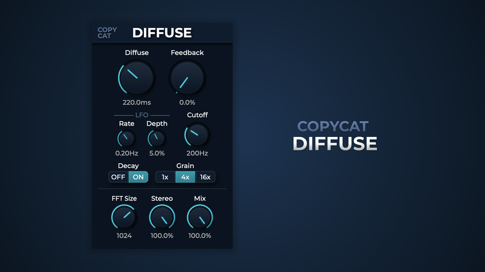
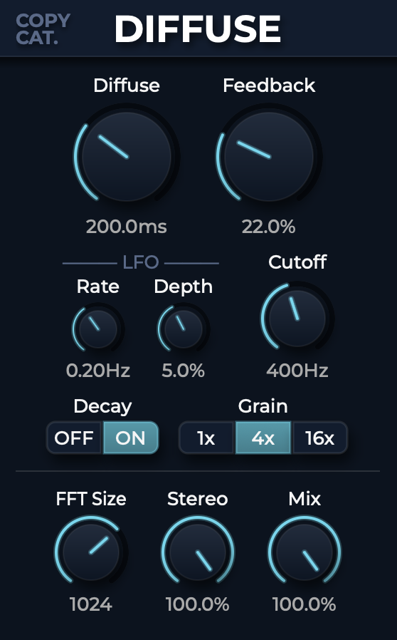

# Diffuse

---

## **Audio plugin / Applying random delays to each frequency band**



---

[Copycat Diffuse](https://copycatmusic.gumroad.com/l/diffuse)

## Audio demos

Compare the original input (Dry) with the processed output (Wet).

| Demo | Dry | Wet |
| --- | --- | --- |
| Demo 1 - vocal | [Original vocal](docs/audio/3_vocal_dry.mp3) | [Grain off](docs/audio/3_vocal_wet%28Reverb%29.mp3) / [Grain on](docs/audio/3_vocal_diffuse.mp3) |
| Demo 2 - synth | [Original synth](docs/audio/1_synth_dry.mp3) | [Processed synth](docs/audio/1_synth_wet.mp3) |

---

## Introduction



<table>
  <tr><td>Diffuse</td><td>Controls the range of the diffused sound. e.g. a 200ms Diffuse means the sound is spread out over 0-200ms</td></tr>
  <tr><td>Feedback</td><td>Feedback </td></tr>
  <tr><td>LFO</td><td>Delay time modulation (percentage) over each band</td></tr>
  <tr><td>Cutoff</td><td>Frequency lower than this value will not be processed</td></tr>
  <tr><td>Decay</td><td>Toggle tail decay for the diffused sound</td></tr>
  <tr><td>Grain</td><td>Sets the grouping size of frequency bins (1x, 4x, 16x) to alter the character of the diffusion from smooth to granulous</td></tr>
  <tr><td>FFT Size</td><td>Larger = more frequency resolution, less time resolution, higher latency</td></tr>
  <tr><td>Stereo</td><td>Adjusts the stereo width by interpolating L/R delay times between correlated (mono) and independent (stereo).</td></tr>
  <tr><td>Mix</td><td>Dry / wet mix</td></tr>
</table>

---

## Build from source

Use **CMake 3.22+**, a C++17 compiler, and the **JUCE 8.0.12 source tree**.
JUCE is an external dependency; it is not vendored into this repository.

```sh
git clone https://github.com/CopycatMusic/CopycatDiffuse.git
cd CopycatDiffuse
git clone --depth 1 --branch 8.0.12 https://github.com/juce-framework/JUCE.git JUCE
```

macOS (Xcode command-line tools required):

```sh
cmake -S . -B build -DCMAKE_BUILD_TYPE=Release -DJUCE_DIR="$PWD/JUCE"
cmake --build build --config Release --parallel 4
```

macOS defaults to `arm64;x86_64`. For an Apple Silicon-only build, add
`-DCMAKE_OSX_ARCHITECTURES=arm64`; use `x86_64` for an Intel-only build.

Windows (Visual Studio 2022 with Desktop development with C++ installed):

```powershell
cmake -S . -B build -G "Visual Studio 17 2022" -A x64 -DJUCE_DIR="$PWD/JUCE"
cmake --build build --config Release --parallel 4
```

These commands build directly with CMake; no packaging or signing script is required.
The local `JUCE/` checkout is ignored by Git.

Outputs are in `build/CopycatDiffuse_artefacts/Release/`:

- **macOS AU:** `AU/CopyCat Diffuse.component`
- **macOS / Windows VST3:** `VST3/CopyCat Diffuse.vst3`

Builds do not install plugins by default. Opt in with
`-DCOPYCAT_COPY_PLUGIN_AFTER_BUILD=ON`, or install the bundles manually as described below.
See [the build guide](docs/BUILDING.md) for more details.

## Install and try

Download the plugin from [Gumroad](https://copycatmusic.gumroad.com/l/diffuse),
or use the bundles built from source above.

Close your DAW before installation. If replacing an existing version, back up the
old plugin first, then copy the complete `.component` or `.vst3` bundle into the
appropriate folder:

| Platform | Format | Plugin directory |
| --- | --- | --- |
| macOS | VST3 | `~/Library/Audio/Plug-Ins/VST3/` |
| macOS | AU | `~/Library/Audio/Plug-Ins/Components/` |
| Windows | VST3 | `C:\Program Files\Common Files\VST3\` |

Reopen your DAW and rescan plugins, then add **CopyCat Diffuse** to an audio track
as an effect. Windows users who download an installer can run it instead of
copying the VST3 bundle manually.

---

## Contact

Copycat

Solo artist & developer, open to co-publishing or technical collaboration.

tg3299182383@gmail.com

<table>
  <tr><td>Bilibili</td><td><a href="https://space.bilibili.com/480123855">https://space.bilibili.com/480123855</a></td></tr>
  <tr><td>Youtube</td><td><a href="https://www.youtube.com/@CopycatCatMusic">CopyCatMusic</a></td></tr>
  <tr><td>Gumroad</td><td><a href="https://copycatmusic.gumroad.com/">Subscribe to CopycatMusic on Gumroad</a></td></tr>
</table>

<!-- Original content: https://copycat-music.notion.site/Diffuse-315043c621268082950edefeafb39bcc?pvs=74; imported 2026-10-14. Audio demos formatted as a table; build and installation guides added. Detailed build instructions: docs/BUILDING.md. -->
